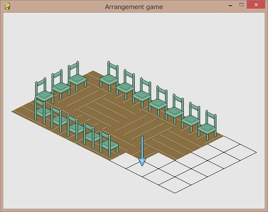

ArrangementGameTry
===

pygameお試し作品。床と椅子を置ける。ディクショナリを使えて喜んでいるのが微笑ましい一品。

- Docker: 対応!
- Python: 3.15!
- Linter: Ruff!
- Test: pytest!
- pygame-ce: 2.5!

## パッと実行してみたい

```bash
docker compose up --build
# ブラウザで http://localhost:6080 を開く
```

ブラウザの中にゲーム画面が出る。
グレーの背景にひし形 10x5 マスの床下地と、動く水色の矢印が見えたら OK。
矢印キーで矢印を動かして、Z で床、A で椅子を置ける。
Docker の中では音は鳴らない (ブラウザ越しには音が届かないので)。止めるときは Ctrl+C。
ブラウザでは Alt+F4 を使わない。ブラウザ自体が閉じてしまう。



## Usage

    KEYS: ACTION
    Arrow keys: Move cursor
    Z: Put floor
    X: Remove item
    C: Roll item which will be put next time
    A: Put chair
    S: Save layout (layout.json)
    L: Load layout
    Backspace: Undo (Z / A / X / L)
    P: Save screenshot (screenshot-日時.png)
    Alt+F4: Quit

    MOUSE: ACTION
    Left click: Z
    Middle click: A
    Right click: X
    Wheel up / down: Up / Down

左上には、次に置く床と椅子が C で選んだ向きで出ている。
矢印キーは押しっぱなしで連続して動く (ほかのキーは押しっぱなしにしても 1 回だけ)。
layout.json と screenshot は ArrangementGameTry.py と同じフォルダにできる (Docker でもこのフォルダに出てくる)。
Linux の Docker でユーザの uid が 1000 じゃないと、このフォルダに書けなくて保存できない (ターミナルに Could not save と出る)。

## Docker なしで動かす

[uv](https://docs.astral.sh/uv/) があれば、ウィンドウで遊べて音も鳴る。
音の出ない環境 (サウンドデバイスがない Linux とか) でも、無音でそのまま動く。

```bash
uv sync
uv run python ArrangementGameTry.py
```

## 開発

```bash
docker compose run --rm game ruff check .
docker compose run --rm game ruff format --check .
docker compose run --rm game pytest
```

テストは SDL の dummy ドライバで動くので、画面がなくても回る。
`tests/golden/original.png` は 2019 年のオリジナル版 (commit e815bd4) が描いた画面で、いまの実装が同じ絵を描けているかの見張り番。
